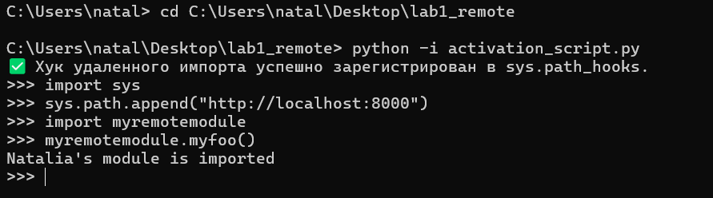
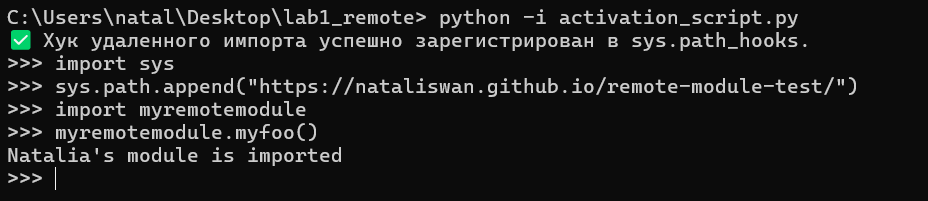
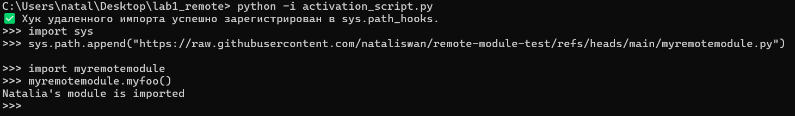
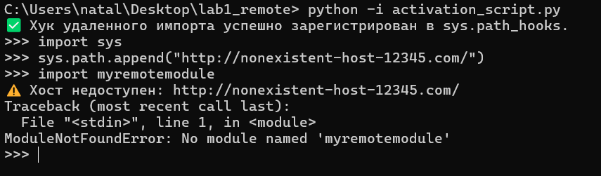
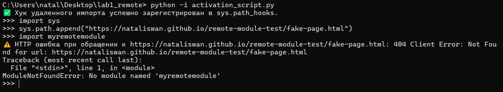
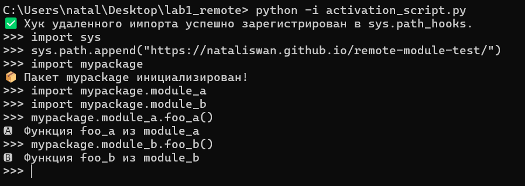

# Лабораторная работа № 1. Реализация удаленного импорта

## Цель работы
Изучить механизм импорта модулей в Python и реализовать собственный загрузчик (Loader) и поисковик (Finder) для импорта модулей и пакетов напрямую с удаленного HTTP-сервера без локального сохранения файлов.

## Ход работы

### Структура проекта
В ходе работы была организована следующая структура файлов. Создан модуль `myremotemodule.py` с функцией `myfoo()`, выводящей имя автора. Для корректного отображения структуры на хостинге создан файл `index.html` со ссылками на доступные Python-файлы и директории.

Для реализации задания про-уровня (***) создана директория `mypackage` с файлами `__init__.py`, `module_a.py`, `module_b.py` и внутренним `index.html`. В корень репозитория добавлен файл `.nojekyll` для отключения обработки файлов с нижним подчеркиванием генератором сайтов GitHub Pages (без этого файла `__init__.py` возвращал бы ошибку 404).

### Базовая реализация механизма импорта
Изначально реализованы три ключевых компонента с использованием стандартной библиотеки `urllib.request`:
- **Класс `URLLoader`**: скачивает исходный код по URL-адресу, компилирует его и выполняет в пространстве имен модуля.
- **Класс `URLFinder`**: наследует `importlib.abc.PathEntryFinder`, проверяет наличие модуля в списке доступных и возвращает объект `ModuleSpec`.
- **Функция `url_hook`**: перехватывает пути в `sys.path`, начинающиеся с `http://` или `https://`, скачивает HTML-страницу и с помощью регулярных выражений извлекает имена `.py` файлов.

**Код скрипта:**
```python
import re
import sys
from urllib.request import urlopen
from importlib.abc import PathEntryFinder
from importlib.util import spec_from_loader

class URLLoader:
    def create_module(self, spec):
        return None
    
    def exec_module(self, module):
        with urlopen(module.__spec__.origin) as response:
            source_bytes = response.read()
        compiled_code = compile(source_bytes, module.__spec__.origin, mode="exec")
        exec(compiled_code, module.__dict__)

class URLFinder(PathEntryFinder):
    def __init__(self, url, available_modules):
        self.url = url
        self.available_modules = available_modules
        
    def find_spec(self, name, target=None):
        if name in self.available_modules:
            origin_url = f"{self.url}/{name}.py"
            loader = URLLoader()
            return spec_from_loader(name, loader, origin=origin_url)
        return None

def url_hook(path_entry):
    if not path_entry.startswith(("http://", "https://")):
        raise ImportError("Этот хук обрабатывает только HTTP/HTTPS адреса")
    
    with urlopen(path_entry) as response:
        html_bytes = response.read()
    
    html_content = html_bytes.decode("utf-8")
    filenames = re.findall(r"[a-zA-Z_][a-zA-Z0-9_]*\.py", html_content)
    available_modules = {name[:-3] for name in filenames}
    
    return URLFinder(path_entry, available_modules)

if url_hook not in sys.path_hooks:
    sys.path_hooks.insert(0, url_hook)

print("✅ Хук удаленного импорта успешно зарегистрирован в sys.path_hooks.")
```

### Тестирование на локальном сервере
Для проверки базовой работоспособности в директории `rootserver` запущен локальный HTTP-сервер командой `python -m http.server 8000`. Продемонстрирован успешный импорт модуля и вызов его функции.

**Результат:**



### Переход на requests и работа с внешними хостингами
Согласно заданию, код был переписан с использованием сторонней библиотеки `requests`, которая предоставляет более удобный интерфейс для HTTP-запросов. При тестировании выявлена проблема бесконечной рекурсии: `requests` при первом вызове импортирует служебные модули (например, `netrc`), которые снова попадают в зарегистрированный хук, порождая новый вызов `requests.get()`.

Для решения проблемы был введен глобальный флаг `_in_hook`, который предотвращает повторный вход в хук при служебных импортах. Также добавлена очистка кэша импортеров через `sys.path_importer_cache.clear()` и поддержка прямых ссылок на `.py` файлы (для Raw GitHub).

**Код скрипта (requests + защита от рекурсии):**
```python
import re
import sys
import requests
from importlib.abc import PathEntryFinder
from importlib.util import spec_from_loader

_in_hook = False

class URLLoader:
    def create_module(self, spec):
        return None
    
    def exec_module(self, module):
        response = requests.get(module.__spec__.origin)
        response.raise_for_status()
        source_code = response.text
        compiled_code = compile(source_code, module.__spec__.origin, mode="exec")
        exec(compiled_code, module.__dict__)

class URLFinder(PathEntryFinder):
    def __init__(self, url, available_modules):
        self.url = url
        self.available_modules = available_modules
        
    def find_spec(self, name, target=None):
        if name in self.available_modules:
            origin_url = f"{self.url}/{name}.py"
            loader = URLLoader()
            return spec_from_loader(name, loader, origin=origin_url)
        return None

def url_hook(path_entry):
    global _in_hook
    if _in_hook:
        raise ImportError("Рекурсивный вызов url_hook — пропускаем")
    
    if not path_entry.startswith(("http://", "https://")):
        raise ImportError("Этот хук обрабатывает только HTTP/HTTPS адреса")
    
    _in_hook = True
    try:
        if path_entry.endswith(".py"):
            module_name = path_entry.split("/")[-1][:-3]
            return URLFinder(path_entry.rsplit("/", 1)[0], {module_name})

        response = requests.get(path_entry)
        response.raise_for_status()
        html_content = response.text
        
        filenames = re.findall(r"[a-zA-Z_][a-zA-Z0-9_]*\.py", html_content)
        available_modules = {name[:-3] for name in filenames}
        return URLFinder(path_entry, available_modules)
    finally:
        _in_hook = False

if url_hook not in sys.path_hooks:
    sys.path_hooks.insert(0, url_hook)
sys.path_importer_cache.clear()

print("✅ Хук удаленного импорта успешно зарегистрирован в sys.path_hooks.")
```

Модуль размещен в публичном репозитории GitHub. Проверена работоспособность импорта через сервис GitHub Pages и через прямые Raw-ссылки.

**Ссылка на GitHub Pages:** 
https://nataliswan.github.io/remote-module-test/

**Результат (GitHub Pages):**


**Результат (Raw GitHub):**


### Обработка исключений при недоступности хоста (*)
Для повышения устойчивости системы в методы `exec_module` и `url_hook` добавлена раздельная обработка сетевых ошибок (`ConnectionError`, `HTTPError`, `Timeout`, `RequestException`) с выводом информативных сообщений вместо стандартного traceback. Установлен таймаут HTTP-запросов в 5 секунд для предотвращения зависания скрипта.

**Код скрипта:**
```python
import re
import sys
import requests
from importlib.abc import PathEntryFinder
from importlib.util import spec_from_loader

_in_hook = False
HTTP_TIMEOUT = 5

class URLLoader:
    def create_module(self, spec):
        return None
    
    def exec_module(self, module):
        try:
            response = requests.get(module.__spec__.origin, timeout=HTTP_TIMEOUT)
            response.raise_for_status()
            source_code = response.text
            compiled_code = compile(source_code, module.__spec__.origin, mode="exec")
            exec(compiled_code, module.__dict__)
        except requests.exceptions.ConnectionError:
            raise ImportError(f"Не удалось подключиться к хосту: {module.__spec__.origin}")
        except requests.exceptions.HTTPError as e:
            raise ImportError(f"HTTP ошибка при загрузке модуля {module.__spec__.origin}: {e}")
        except requests.exceptions.Timeout:
            raise ImportError(f"Превышено время ожидания при загрузке: {module.__spec__.origin}")
        except requests.exceptions.RequestException as e:
            raise ImportError(f"Ошибка при загрузке модуля {module.__spec__.origin}: {e}")

class URLFinder(PathEntryFinder):
    def __init__(self, url, available_modules):
        self.url = url
        self.available_modules = available_modules
        
    def find_spec(self, name, target=None):
        if name in self.available_modules:
            origin_url = f"{self.url}/{name}.py"
            loader = URLLoader()
            return spec_from_loader(name, loader, origin=origin_url)
        return None

def url_hook(path_entry):
    global _in_hook
    if _in_hook:
        raise ImportError("Рекурсивный вызов url_hook — пропускаем")
    if not path_entry.startswith(("http://", "https://")):
        raise ImportError("Этот хук обрабатывает только HTTP/HTTPS адреса")
    
    _in_hook = True
    try:
        if path_entry.endswith(".py"):
            module_name = path_entry.split("/")[-1][:-3]
            return URLFinder(path_entry.rsplit("/", 1)[0], {module_name})

        response = requests.get(path_entry, timeout=HTTP_TIMEOUT)
        response.raise_for_status()
        html_content = response.text
        
        filenames = re.findall(r"[a-zA-Z_][a-zA-Z0-9_]*\.py", html_content)
        available_modules = {name[:-3] for name in filenames}
        return URLFinder(path_entry, available_modules)
    
    except requests.exceptions.ConnectionError:
        print(f"⚠️ Хост недоступен: {path_entry}")
        return None
    except requests.exceptions.HTTPError as e:
        print(f"⚠️ HTTP ошибка при обращении к {path_entry}: {e}")
        return None
    except requests.exceptions.Timeout:
        print(f"⚠️ Превышено время ожидания: {path_entry}")
        return None
    except requests.exceptions.RequestException as e:
        print(f"⚠️ Ошибка запроса к {path_entry}: {e}")
        return None
    finally:
        _in_hook = False

if url_hook not in sys.path_hooks:
    sys.path_hooks.insert(0, url_hook)
sys.path_importer_cache.clear()

print("✅ Хук удаленного импорта успешно зарегистрирован в sys.path_hooks.")
```

**Результаты тестирования:**

*Ошибка соединения (несуществующий хост):*


*HTTP-ошибка 404 (страница не найдена):*


### Реализация импорта пакетов (***)
Для поддержки импорта пакетов метод `find_spec` класса `URLFinder` был расширен. При обнаружении пакета используется аргумент `is_package=True` и явно задается атрибут `submodule_search_locations`, указывающий интерпретатору путь для поиска вложенных модулей. Также добавлена логика корректного построения URL для вложенных модулей (с проверкой, не указывает ли базовый URL уже на папку пакета, чтобы избежать задвоения пути в ссылке).

В функции `url_hook` дополнительно реализован поиск директорий (путей, заканчивающихся на `/`), что позволяет распознавать пакеты при сканировании удаленного каталога.

**Код скрипта:**
```python
import re
import sys
import requests
from importlib.abc import PathEntryFinder
from importlib.util import spec_from_loader

_in_hook = False
HTTP_TIMEOUT = 5

class URLLoader:
    def create_module(self, spec):
        return None
    
    def exec_module(self, module):
        try:
            response = requests.get(module.__spec__.origin, timeout=HTTP_TIMEOUT)
            response.raise_for_status()
            source_code = response.text
            compiled_code = compile(source_code, module.__spec__.origin, mode="exec")
            exec(compiled_code, module.__dict__)
        except requests.exceptions.ConnectionError:
            raise ImportError(f"Не удалось подключиться к хосту: {module.__spec__.origin}")
        except requests.exceptions.HTTPError as e:
            raise ImportError(f"HTTP ошибка при загрузке модуля {module.__spec__.origin}: {e}")
        except requests.exceptions.Timeout:
            raise ImportError(f"Превышено время ожидания при загрузке: {module.__spec__.origin}")
        except requests.exceptions.RequestException as e:
            raise ImportError(f"Ошибка при загрузке модуля {module.__spec__.origin}: {e}")

class URLFinder(PathEntryFinder):
    def __init__(self, url, available_modules, available_packages):
        self.url = url.rstrip('/')
        self.available_modules = available_modules
        self.available_packages = available_packages
        
    def find_spec(self, fullname, target=None):
        # 1. Обработка вложенных модулей (например, mypackage.module_a)
        if '.' in fullname:
            parts = fullname.split('.')
            if self.url.rstrip('/').endswith(parts[0]):
                module_name = parts[-1]
                origin_url = f"{self.url}/{module_name}.py"
            else:
                file_path = '/'.join(parts)
                origin_url = f"{self.url}/{file_path}.py"
            loader = URLLoader()
            return spec_from_loader(fullname, loader, origin=origin_url)

        # 2. Обработка обычных модулей
        if fullname in self.available_modules:
            origin_url = f"{self.url}/{fullname}.py"
            loader = URLLoader()
            return spec_from_loader(fullname, loader, origin=origin_url)

        # 3. Обработка пакетов — задание (***)
        if fullname in self.available_packages:
            origin_url = f"{self.url}/{fullname}/__init__.py"
            loader = URLLoader()
            spec = spec_from_loader(fullname, loader, origin=origin_url, is_package=True)
            if spec is not None:
                spec.submodule_search_locations = [f"{self.url}/{fullname}"]
            return spec
        return None

def url_hook(path_entry):
    global _in_hook
    if _in_hook:
        raise ImportError("Рекурсивный вызов url_hook — пропускаем")
    if not path_entry.startswith(("http://", "https://")):
        raise ImportError("Этот хук обрабатывает только HTTP/HTTPS адреса")
    
    _in_hook = True
    try:
        if path_entry.endswith(".py"):
            module_name = path_entry.split("/")[-1][:-3]
            return URLFinder(path_entry.rsplit("/", 1)[0], {module_name}, set())

        response = requests.get(path_entry, timeout=HTTP_TIMEOUT)
        response.raise_for_status()
        html_content = response.text
        
        filenames = re.findall(r"[a-zA-Z_][a-zA-Z0-9_]*\.py", html_content)
        available_modules = {name[:-3] for name in filenames}
        
        dirnames = re.findall(r"[a-zA-Z_][a-zA-Z0-9_]*/", html_content)
        available_packages = {name[:-1] for name in dirnames}
        
        return URLFinder(path_entry, available_modules, available_packages)
    
    except requests.exceptions.ConnectionError:
        print(f"⚠️ Хост недоступен: {path_entry}")
        return None
    except requests.exceptions.HTTPError as e:
        print(f"⚠️ HTTP ошибка при обращении к {path_entry}: {e}")
        return None
    except requests.exceptions.Timeout:
        print(f"⚠️ Превышено время ожидания: {path_entry}")
        return None
    except requests.exceptions.RequestException as e:
        print(f"⚠️ Ошибка запроса к {path_entry}: {e}")
        return None
    finally:
        _in_hook = False

if url_hook not in sys.path_hooks:
    sys.path_hooks.insert(0, url_hook)
sys.path_importer_cache.clear()

print("✅ Хук удаленного импорта успешно зарегистрирован в sys.path_hooks.")
```

**Результат:**



---
**Выполнила:** Лебедева Наталия, 3 курс, ИВТ-1.2
